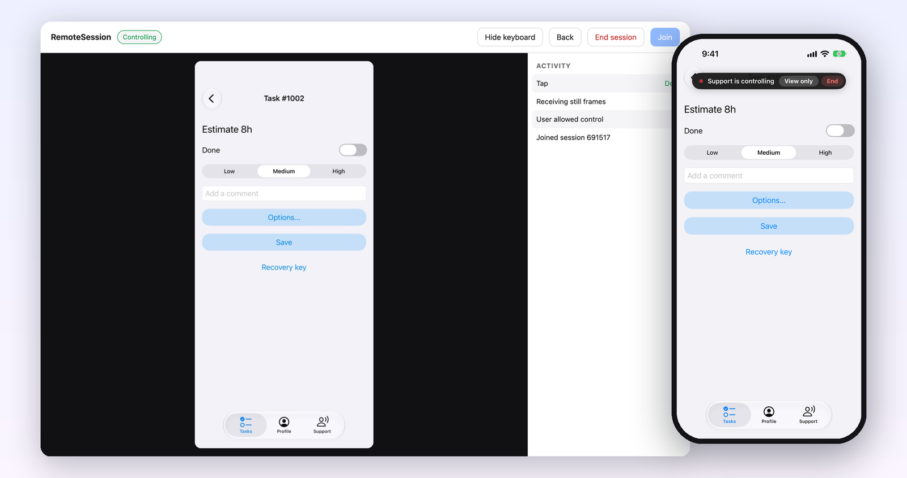
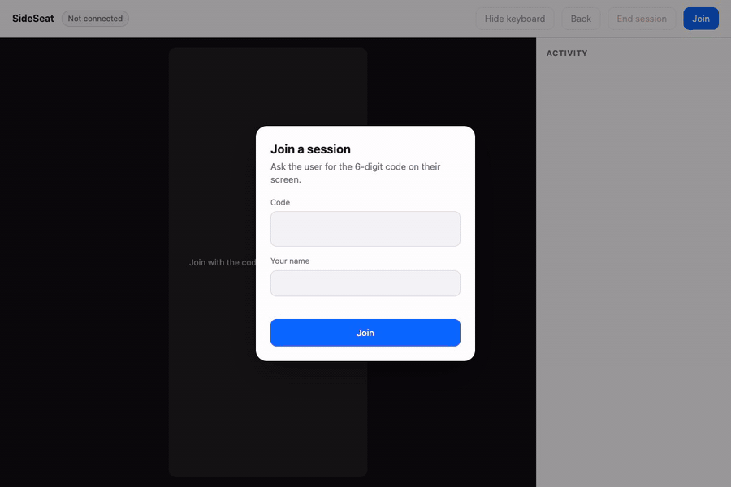

<h1 align="center">RemoteSession</h1>

<p align="center">
  <strong>In-app remote support for iOS and Android.</strong><br>
  See your user's screen and, with their consent, help them through it. No screen sharing app, no private APIs.
</p>

<p align="center">
  <a href="https://github.com/mohameditani91/Remote-Session/actions/workflows/ci.yml"></a>
  
  
  
  
  
  <a href="LICENSE"></a>
</p>

<p align="center">
  
</p>

A support agent opens a web page, types the 6-digit code shown in your app, and sees the user's screen live. With the user's consent, the agent can also tap, scroll, type and go back.

## Features

- **Public APIs only.** On iOS that means App Store safe: no touch synthesis, no private selectors. Agent input is replayed the way UIKit itself would handle it: control actions, table and collection selection through their delegates, popovers closing through their delegates, scroll offsets, text input. On Android it's delivered as touch, wheel and key events to the app's own windows.
- **Consent first.** Nothing streams until the user allows viewing, or viewing and control. The user can drop to view-only or end the session at any time from a banner they can drag out of the way, and an animated marker shows each tap the agent makes.
- **Ask before it matters.** One call asks the user to allow an action the agent started, like deleting or paying, and lets it straight through when the user started it.
- **Masking.** Secure text fields are always covered with a blurred placeholder. Mark anything else with one property, or mask whole screens with a rule.
- **Video or stills.** Opt in to H.264 video at up to 30 fps when the agent's browser can decode it, with JPEG stills otherwise. It comes from ReplayKit on iOS and from the app's own windows on Android.
- **Small.** On iOS, about 2,800 lines of Swift with no dependencies, for iOS 15+ with UIKit and SwiftUI. On Android, about 2,400 lines of Kotlin with OkHttp as its one dependency, for Android 10+ with Views and Compose.
- **Bring your own backend.** A small reference relay and agent console are included for local development. The transport is a protocol, so you can run sessions over your own infrastructure.

## See it in action

Over H.264 video, an agent opens a task, marks it done, sets the priority, types a comment with the drawn keyboard showing, and saves. Then they try to open the recovery key: the user is asked first, allows it on the phone, and the screen reaches the agent masked. Every input shows up in the activity log with its result.

<p align="center">
  
</p>

| Pairing and consent | What the user sees vs. what the agent sees |
| :---: | :---: |
|  |  |

## Try it in two minutes

You need Node 18+, and Xcode 15+ for iOS or Android Studio for Android.

1. Start the relay and console:
   ```bash
   cd Examples/Relay && npm install && npm start
   ```
2. iOS: open `Examples/SampleApp/SampleApp.xcodeproj` and run it on a simulator. Android: open the `Android` folder in Android Studio and run `sample` on an emulator.
3. In the sample app, open the **Support** tab and tap **Start support session**. A code appears.
4. Open http://localhost:8080, enter the code and your name, and approve the request in the app.

Click on the screen to tap, use the trackpad or wheel to scroll, and type with the console focused. To test on a real device, run the relay with `HOST=0.0.0.0` and point the sample app at your Mac's IP in the Support tab. The Android emulator reaches your Mac at `10.0.2.2`, which the Android sample uses by default.

## Add it to your app

Swift Package Manager: in Xcode choose **File › Add Package Dependencies…** and enter the repository URL, or add it to `Package.swift`:

```swift
.package(url: "https://github.com/mohameditani91/Remote-Session.git", from: "0.1.0")
```

Then add the `RemoteSession` product to your target, as `.product(name: "RemoteSession", package: "Remote-Session")` in `Package.swift`.

```swift
import RemoteSession

var configuration = RemoteSession.Configuration(relay: URL(string: "wss://support.example.com/device")!)
RemoteSession.shared.start(in: windowScene, configuration: configuration)
```

`RemoteSession.shared.end()` stops the session, and `onStateChange` reports `connecting`, `waitingForAgent(code:)`, `awaitingConsent`, `active(mode:)` and `ended`.

## What the agent can do

| Input | Handled |
| --- | --- |
| Tap | Buttons and other controls (`touchDown`, `touchUpInside` and primary actions), switches, segmented controls, sliders, text fields, table and collection cells (`willSelect`/`shouldSelect`/`didSelect` honored), navigation bar and toolbar items (iOS 17+), popovers closing on an outside tap (delegate honored), accessibility-activatable views, `RemoteSessionTapGestureRecognizer`, SwiftUI views marked with `.remoteSessionTarget`, `.remoteSessionTapGesture` or `.remoteSessionButton()`, and keys on the drawn keyboard |
| Scroll | The scroll view under the pointer that can move in that direction, clamped to its content. Sideways over a `RemoteSessionSwipeable` row, it opens the row's swipe actions |
| Type | Text, Backspace and Return into the focused field (`textFieldShouldReturn` honored) |
| Back | Pops the visible navigation stack, or dismisses a modal |
| Hide keyboard | Resigns the focused field |

The system keyboard runs outside your app, so the agent sees a drawn keyboard in its place and can tap its keys. It is blurred and locked while a password or masked field has focus.

Things it can't drive, by design: plain gesture recognizers, web views, games, and SwiftUI gestures and controls (`Toggle`, `Slider`, `Picker`) without a marker. A tap on an unmarked SwiftUI control reports `swiftUIControl` rather than a false success. Make them reachable with:

```swift
// UIKit: views driven by taps
let tap = RemoteSessionTapGestureRecognizer(target: self, action: #selector(cardTapped))  // instead of UITapGestureRecognizer

// UIKit: anything else
extension MyCardCell: RemoteSessionTappable {
    func remoteSessionTap(at point: CGPoint) -> Bool {
        toggleExpanded()
        return true
    }
}

// UIKit: rows with swipe actions, for example SwipeCellKit cells
extension MyRowCell: RemoteSessionSwipeable {
    func remoteSessionSwipe(by delta: CGVector) -> Bool {
        showSwipe(orientation: delta.dx > 0 ? .right : .left)   // scrolling right is a finger swiping left
        return true
    }
}

// SwiftUI
Card().remoteSessionTapGesture { likes += 1 }   // instead of .onTapGesture
Button("Pay") { pay() }.remoteSessionButton()   // keeps the button's style
Toggle("Done", isOn: $done).remoteSessionTarget { done.toggle() }
```

## Video

```swift
configuration.video = true
```

The app then streams H.264 video captured with ReplayKit to any agent whose browser can decode it (WebCodecs, in current Chrome, Edge and Safari), and JPEG stills to the rest. iOS asks the user to allow screen recording first. If they don't, or capture fails or goes quiet, the session carries on with stills.

Video costs almost no main-thread time, so the picture stays smooth while the user scrolls. Masks and the drawn keyboard are painted over each recorded frame from a snapshot taken right after it arrives, together with the previous snapshot, so a masked view that moves stays covered. On the simulator, where ReplayKit doesn't capture, frames come from window snapshots at 15 fps.

## Ask before sensitive actions

Wrap anything the user should approve. When the agent's input led to it, the user sees an Allow / Deny card and agent input waits for the answer. When the user did it themselves, the completion runs straight away.

```swift
RemoteSession.shared.confirmAgentAction("Delete \"\(task.title)\"") { allowed in
    if allowed { store.delete(task) }
}
```

`isAgentAction` stays true for 90 seconds after the agent's last input that did something, and ends as soon as the user touches the screen.

## Audit log

```swift
RemoteSession.shared.onInput = { event in
    log("\(event.input) on \(event.target ?? "nothing") in \(event.screen ?? "?"): \(event.result.outcome)")
}
```

`target` is a short name such as `"Save" button`, `"Email" field` or `row 3`. It comes from titles, placeholders and accessibility labels; typed text, row text, labels and masked areas are never read.

## Masking

```swift
pinLabel.isRemoteSessionMasked = true                               // a UIKit view
Text(cardNumber).remoteSessionMasked()                              // a SwiftUI view
configuration.maskRule = MaskRules.screens([PaymentViewController.self])   // whole screens
```

Secure text fields, including SwiftUI `SecureField`, are always masked. Masks are drawn into each frame before it leaves the device, and they follow scrolling. The agent sees blurred blank tiles there, never a blur of what is underneath.

## Extension points

| Configuration | Use it to |
| --- | --- |
| `request` | Add authentication headers or query items to the relay connection |
| `transport` | Replace the WebSocket with your own `RemoteSessionTransport` |
| `inputInterceptor` | Block or handle agent input yourself, for example on payment screens |
| `consentHandler` | Show your own consent UI instead of the built-in card |
| `maskRule` | Decide which views to mask |
| `allowsControl` | Offer viewing only |
| `video` | Stream H.264 video when the agent's browser can decode it |
| `framesPerSecond`, `scale`, `jpegQuality`, `mainThreadBudget` | Trade picture quality for bandwidth and main-thread time |
| `strings`, `tint` | Localize and theme the built-in UI |
| `tapIndicatorColor` | Change or hide (`nil`) the marker shown at each agent tap |

## Protocol

JSON text messages plus binary frames over one WebSocket per side. The relay pairs one app with one agent by code.

| From | Message |
| --- | --- |
| Relay → app | `session {code}`, `agentJoined {agentId, agentName, video}`, `agentLeft`, `input {id, action, …}`, `requestKeyframe`, `end {reason}` |
| App → relay | `consent {mode}`, `denied`, `screen {width, height}`, `result {id, outcome, reason}`, `mode {mode}`, `approval {action, allowed?}`, `end {reason}`, binary frames |
| Agent → relay | `input {id, action: tap\|scroll\|text\|key\|back\|hideKeyboard, …}`, `requestKeyframe`, `end` |

Coordinates are normalized to 0…1 of the app's window scene.

Binary frames are either a bare JPEG (first byte `0xFF`) or one H.264 access unit with a 7-byte header: version `1`, kind `2`, a big-endian `uint32` sequence number, and a flags byte whose bit 0 marks a keyframe. Payloads are Annex-B, and every keyframe carries its SPS and PPS. The app sends video only when `agentJoined.video` lists `h264`; the reference console asks for it by adding `video=h264` to its join URL when `VideoDecoder` supports H.264. After a sequence gap or a decoder error it sends `requestKeyframe`, and the app answers with a keyframe within half a second.

## Before you ship it

The relay in `Examples/Relay` is a starting point for development. It has an optional shared device token (`DEVICE_TOKEN`) and nothing else. For production, run the relay behind TLS (`wss://`), authenticate agents, make codes short-lived and rate-limit attempts, keep an audit log, and decide which screens to mask or block.

## Limitations

- Still frames are drawn on the main thread with `drawHierarchy`. Frame rate drops automatically when a capture takes longer than `mainThreadBudget`. Expect 1–2 fps on the simulator. Video avoids this.
- With video, masks are applied to the recording after capture rather than while drawing. Keep JPEG for screens where that difference matters to you.
- The drawn keyboard is a fixed US layout without Shift; the agent can type anything else from their own keyboard. Liquid Glass and other blur materials may render without their background.
- One agent per session. If the connection drops, the session ends and the user starts a new one.

## Android

The Android library in [`Android/remotesession`](Android/remotesession) speaks the same protocol, so the relay and console work unchanged. It needs Android 10 (API 29) or later and works with Views and Compose. The sample app in [`Android/sample`](Android/sample) mirrors the iOS one: a Views task list and detail screen, and Compose profile and support screens.

Its one dependency is OkHttp, for the WebSocket. It isn't published to Maven yet. Copy the `remotesession` folder into your project, add `include(":remotesession")` to `settings.gradle.kts`, and depend on it:

```kotlin
implementation(project(":remotesession"))
```

```kotlin
import dev.remotesession.RemoteSession

val configuration = RemoteSession.Configuration("wss://support.example.com/device").apply { video = true }
RemoteSession.start(activity, configuration)
```

The API follows the iOS one: `end()`, `onStateChange`, `onInput`, `confirmAgentAction(...)`, `inputInterceptor`, `consentHandler` and `maskRule`. The built-in cards use string resources named `remotesession_*`, so you translate them like any other string.

```kotlin
pinView.isRemoteSessionMasked = true                                // a View
Text(cardNumber, Modifier.remoteSessionMasked())                    // a composable
configuration.maskRule = MaskRules.activities(PaymentActivity::class) // whole screens
```

How it differs from iOS:

- **Frames come from the app's own windows**: activities, dialogs, popups and menus. They're drawn on the render thread, so nothing outside the app is ever captured: no status bar, no notifications, no other apps.
- **Video needs no prompt.** With `video = true` those same masked frames are encoded to H.264 with `MediaCodec`, so there is no screen recording, no system dialog and no foreground service.
- **Input reaches Views and Compose alike.** Taps are touch events sent to the window under the point, scrolls are mouse-wheel events, and text goes into the focused field. Compose needs no markers.
- **Password fields are always masked.** That covers `EditText` with a password input type, and Compose fields with a password transformation, found through Compose's semantics tree.
- **Back at the root returns `nothingToGoBack`** instead of closing the app.

Limitations:

- **Tested on one device so far,** an API 37 emulator. Video's cost to the app's frame rate on real hardware isn't measured yet.
- **Predictive back.** A dialog that only handles predictive back may ignore the agent's Back.
- **Lint warnings.** Compose is read through `ViewRootForTest`, a public interface meant for tests, so lint may warn about it.

## Security

To report a vulnerability, follow [SECURITY.md](SECURITY.md). Please don't open a public issue.

## License

MIT. See [LICENSE](LICENSE).
